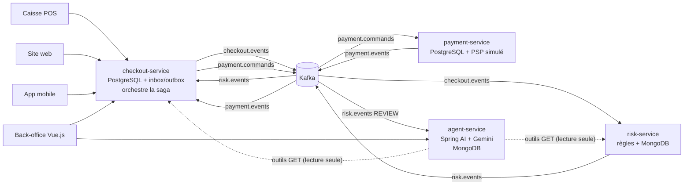
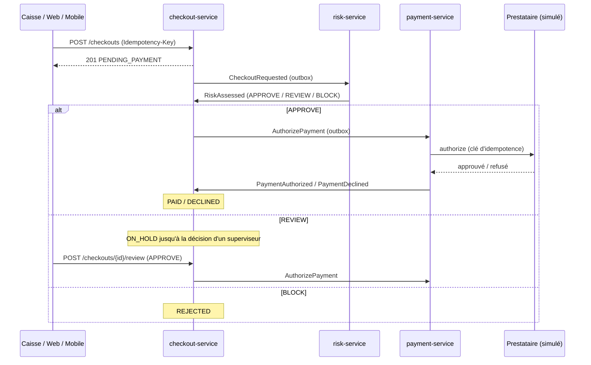

# Smart Checkout AI


Plateforme d'**encaissement omnicanal** (caisse en magasin, site web, application mobile) construite en **microservices event-driven**, avec un **agent IA** qui assiste l'analyse des paiements suspects.

> Projet personnel de démonstration, construit étape par étape : Java 21, Spring Boot 4, Kafka, PostgreSQL, MongoDB, Spring AI, Vue.js 3.

## Architecture cible



| Étape | Contenu | Statut |
|---|---|---|
| 1 | `checkout-service` : API REST idempotente, PostgreSQL, outbox → Kafka, tests, CI | ✅ |
| 2 | `risk-service` : score de risque explicable, consommateur idempotent, MongoDB, dead-letter topic | ✅ |
| 3 | `payment-service` + saga orchestrée par le checkout : PSP simulé idempotent, inbox/outbox, validation humaine | ✅ |
| 4 | `agent-service` : agent Spring AI + Gemini qui enquête sur les paiements en attente (outils en lecture seule, sortie structurée validée, repli par règles, modèle de secours, audit) ; un humain décide | ✅ |
| 5 | Front Vue.js 3 : caisse et back-office | 🚧 |
| 6 | Qualité : SonarCloud, couverture, observabilité | 🚧 |

## Choix techniques

- **Architecture hexagonale** : domaine en Java pur, ports et adaptateurs, règles vérifiées par ArchUnit → [ADR 0001](docs/adr/0001-architecture-hexagonale.md)
- **Outbox transactionnelle** : l'encaissement et son événement sont enregistrés dans la même transaction, aucun événement perdu → [ADR 0002](docs/adr/0002-outbox-transactionnelle.md)
- **Idempotence** (`Idempotency-Key`), **montants en centimes**, **aucun numéro de carte** (jeton PSP, PCI-DSS) → [ADR 0003](docs/adr/0003-idempotence-et-montants.md)
- **Erreurs normalisées** RFC 9457 (`ProblemDetail`) : 400 format, 404, 409 doublon simultané, 422 règle métier
- **Contrats d'événements** typés (interface `sealed` + discriminant `type`) dans un module partagé sans framework
- **Score de risque explicable** : règles indépendantes (montant, vélocité de la carte, pays carte/IP, nouvel appareil), score entier sur 100, chaque décision accompagnée de ses raisons ; ajouter une règle = ajouter une classe (principe ouvert/fermé)
- **Consommateur idempotent**, temps de l'événement, dead-letter topic ; jeton de carte jamais stocké (empreinte SHA-256) → [ADR 0004](docs/adr/0004-consommateur-idempotent.md)
- **Saga** : chorégraphie pour le risque, orchestration du paiement par le checkout, **inbox + outbox** (chaque événement appliqué une seule fois), **validation humaine** des paiements en attente, paiement idempotent jusqu'au prestataire (clé d'idempotence, état `AUTHORIZING` avant l'appel, pas de transaction ouverte pendant l'appel distant) → [ADR 0005](docs/adr/0005-saga-encaissement.md)
- **Agent IA (human-in-the-loop)** : sur chaque paiement mis en attente, un agent Spring AI + Gemini appelle des outils en lecture seule (décision du moteur, panier, historique du client) et produit un rapport structuré, validé par le domaine. Il recommande, le superviseur décide. Garde-fous : arguments validés, limites d'appels, budget quotidien, résultats d'outils traités comme des données ; modèle de secours sur 503/429 ; repli par règles sans clé ou en cas d'erreur ; trace d'audit (modèle, outils, durée) → [ADR 0006](docs/adr/0006-agent-ia-recommande-humain-decide.md)

### Parcours d'un paiement



### Décisions du risk-service

| Score | Décision | Exemple |
|---|---|---|
| 0 – 39 | `APPROVE` | achat en caisse de 114,30 MAD |
| 40 – 69 | `REVIEW` (mise en attente, analysée par l'agent IA) | 8 999 MAD en ligne, carte FR, IP MA → 60 ; 5e paiement en 10 min avec la même carte → 45 |
| 70 – 100 | `BLOCK` | 25 000 MAD en ligne, carte FR, IP MA → 80 |

## Stack

Java 21 · Spring Boot 4.1 · Spring AI 2.0 (Gemini, tool calling, sortie structurée) · Spring Data JPA (Hibernate 7) · Flyway · Spring Kafka · Apache Kafka 4.1 (KRaft) · PostgreSQL 17 · MongoDB 8 · JUnit 6 · AssertJ · ArchUnit · Testcontainers 2 · Docker · GitHub Actions

## Démarrage rapide

Prérequis : Docker Desktop, JDK 21 (ou IntelliJ IDEA).

```bash
# 0. Optionnel, agent IA : copier .env.example en .env, puis AI_CHAT_MODEL=google-genai et GEMINI_API_KEY=<clé>
#    (.env est ignoré par git ; sans clé, l'agent produit ses rapports avec des règles)
cp .env.example .env

# 1. Infrastructure : PostgreSQL, MongoDB, Kafka, Kafka UI
docker compose up -d

# 2a. Lancer les services depuis l'IDE (CheckoutServiceApplication, RiskServiceApplication, PaymentServiceApplication, AgentServiceApplication), ou :
# 2b. tout lancer dans Docker
docker compose --profile app up -d --build
```

Essayer l'API : ouvrir [`docs/requests.http`](docs/requests.http) dans IntelliJ, ou lancer `scripts/new-checkout.ps1` sous Windows.

| Service | URL |
|---|---|
| checkout-service | http://localhost:18101/api/v1/checkouts |
| risk-service | http://localhost:18102/api/v1/risk-assessments/{checkoutId} |
| payment-service | http://localhost:18103/api/v1/payments/{checkoutId} |
| agent-service | http://localhost:18104/api/v1/investigations |
| Santé | `/actuator/health` sur chaque port |
| Kafka UI | http://localhost:18190 |

### API `checkout-service`

| Méthode | Chemin | Réponses |
|---|---|---|
| `POST` | `/api/v1/checkouts` (en-tête `Idempotency-Key`) | 201 créé · 200 rejeu · 400 · 409 · 422 |
| `GET` | `/api/v1/checkouts/{id}` | 200 · 404 |
| `GET` | `/api/v1/checkouts?limit=50` | 200 (liste résumée, sans lignes de panier) |
| `POST` | `/api/v1/checkouts/{id}/review` (`APPROVE` / `REJECT`, superviseur, commentaire) | 200 · 404 · 422 si l'encaissement n'est pas en attente |

### API `risk-service`

| Méthode | Chemin | Réponses |
|---|---|---|
| `GET` | `/api/v1/risk-assessments/{checkoutId}` | 200 (score, décision, raisons) · 404 |
| `GET` | `/api/v1/risk-assessments?customerId=…&limit=20` | 200 (historique du client, le plus récent d'abord) |

### API `payment-service`

| Méthode | Chemin | Réponses |
|---|---|---|
| `GET` | `/api/v1/payments/{checkoutId}` | 200 (statut, référence du prestataire, motif de refus) · 404 |

### API `agent-service`

| Méthode | Chemin | Réponses |
|---|---|---|
| `GET` | `/api/v1/investigations/{checkoutId}` | 200 (recommandation, confiance, résumé, preuves, questions, outils appelés) · 404 |
| `GET` | `/api/v1/investigations?limit=20` | 200 (dernières enquêtes) |
| `POST` | `/api/v1/investigations/{checkoutId}` | 200 nouvelle enquête · 404 encaissement inconnu · 503 risk-service indisponible |

L'agent ne fait que recommander : la décision reste au superviseur (`POST /api/v1/checkouts/{id}/review`). Sans clé Gemini (`AI_CHAT_MODEL=none`), le rapport est produit par des règles.

Les paiements démarrent uniquement par la commande Kafka `AuthorizePayment`. Jetons de test du prestataire simulé : `insufficient`, `expired`, `stolen` (refus), `flaky` (2 pannes puis succès), montant > 50 000 MAD (plafond).

## Tests

```bash
mvn verify
```

- **Domaine** (`CheckoutTest`, `RiskEngineTest`, `PaymentTest`, `InvestigationReportTest`, `FallbackAdvisorTest`) : règles métier en Java pur.
- **Cas d'usage** (`CheckoutServiceTest`, `CheckoutOrchestratorTest`, `RiskAssessmentServiceTest`, `PaymentServiceTest`, `InvestigationServiceTest`) : ports remplacés par des implémentations en mémoire (idempotence, rejeu, saga, reprise après panne, repli de l'agent).
- **Agent IA sans LLM** (`InvestigationToolsTest`, `AgentAnswerTest`, `ModelFallbackTest`) : garde-fous des outils, validation de la réponse du modèle, bascule de modèle sur 503/429, sans appel réseau ni clé.
- **Architecture** (`ArchitectureTest` dans chaque service) : le domaine ne dépend d'aucun framework, l'application ne dépend pas de l'infrastructure.
- **Intégration** (Testcontainers, conteneurs partagés par JVM) :
  - `CheckoutApiIntegrationTest` (PostgreSQL + Kafka) : API, outbox, saga APPROVE → commande → `PAID`, mise en attente puis validation humaine ;
  - `RiskServiceIntegrationTest` (MongoDB + Kafka) : décision explicable, rejeu idempotent, dead-letter topic ;
  - `PaymentServiceIntegrationTest` (PostgreSQL + Kafka) : autorisation, rejeu sans second débit, refus, prestataire instable relancé ;
  - `AgentServiceIntegrationTest` (MongoDB + Kafka, IA désactivée) : paiement en attente → rapport, paiement approuvé ignoré, 503 si risk-service est indisponible.

La CI GitHub Actions exécute l'ensemble à chaque push.

## Auteur

Omar Boukherys · [LinkedIn](https://www.linkedin.com/in/omar-boukherys-a891191b2)
